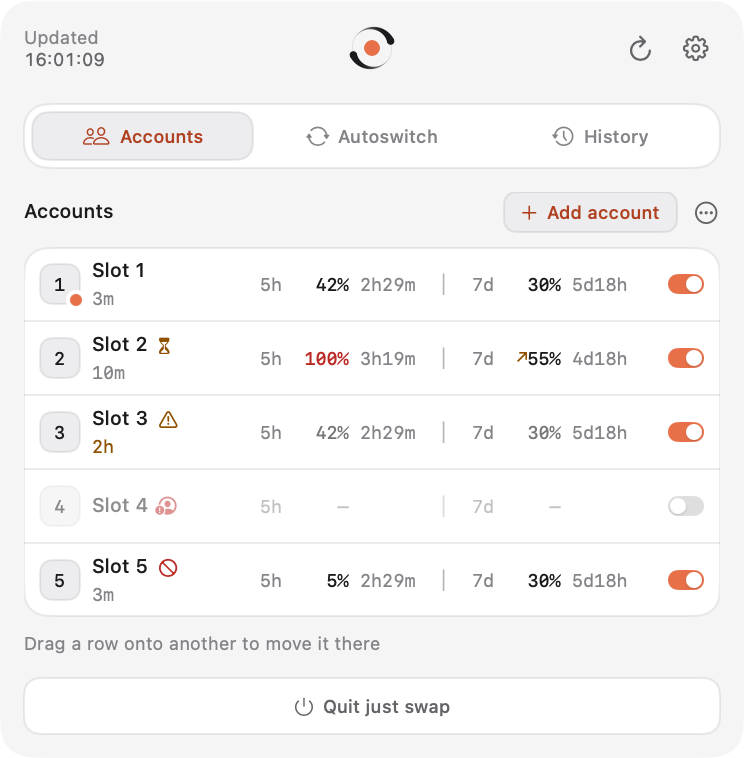
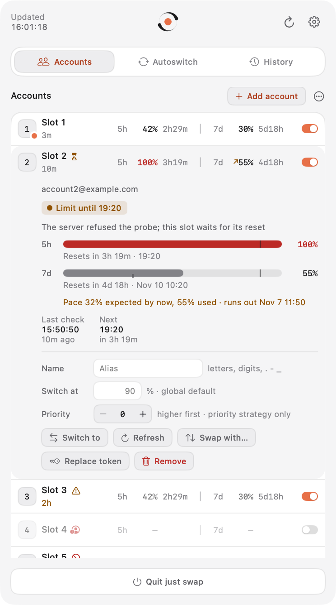
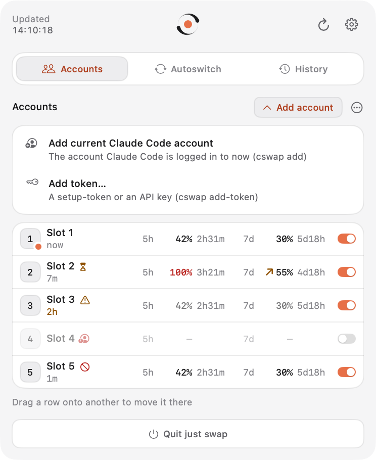
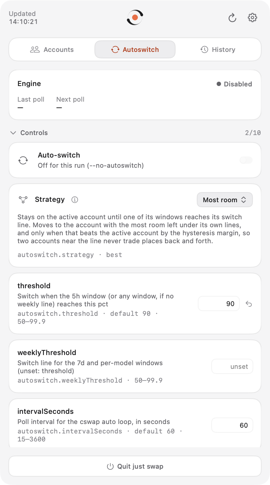
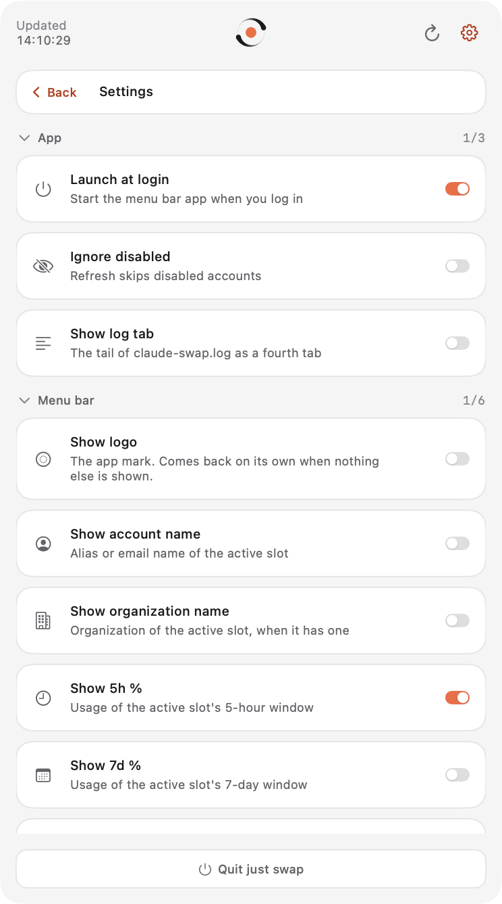
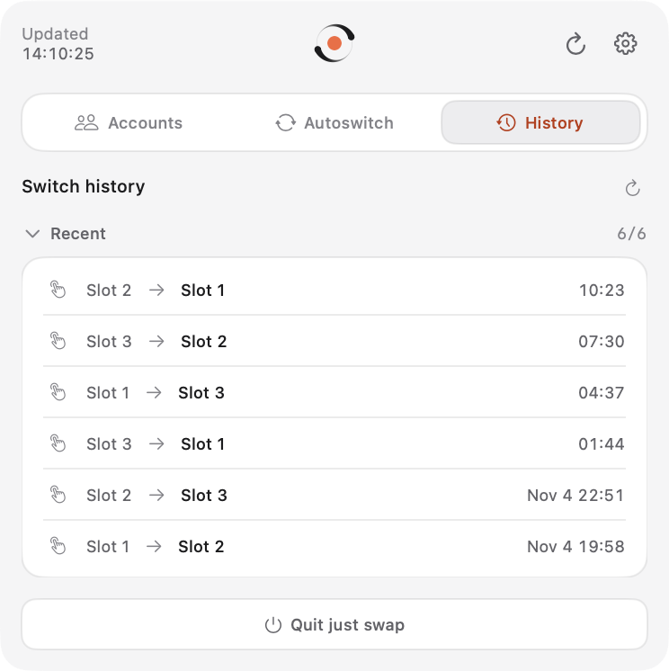

<p align="center">
  
</p>

<h1 align="center">just swap</h1>

<p align="center"><strong>Hit a limit. Keep coding. It's swapped.</strong></p>

<p align="center">
  <a href="https://github.com/n-kasatkin/just-swap/releases/latest/download/just-swap.dmg"><strong>Download just-swap.dmg</strong></a><br>
  A menu bar app for Claude Code with several accounts<br>
  macOS 26+, Apple Silicon · signed and notarized
</p>

<p align="center">
  
</p>

## How it works

1. You add your Claude accounts once with claude-swap (`cswap add` while logged in to each).
2. just swap sits in the menu bar and shows every account with its 5-hour and 7-day usage.
3. When the active account nears its limit, it switches Claude Code to the account with the most quota left. You keep working.

You can also switch by hand, hold an account out of rotation, rename, reorder, add or remove accounts, or turn autoswitch off, all from the popover.

## Why it's light

- The menu bar app is native SwiftUI, 3.7 MiB of code. No Electron, no web view.
- At idle the app uses 20 MB of memory (physical footprint) and 0.1% CPU; the autoswitch loop, a Python child, adds 26 MB at 0.0% CPU.
- The download is 38.2 MB. The installed app is 90.7 MiB; 85.4 MiB of that (94%) is the bundled Python with the claude-swap core, so you install nothing else: no Homebrew, no pip, no system Python.
- The popover reads stored values. Only Refresh and the autoswitch loop ask Anthropic for usage, so opening it never spends quota.
- No account, subscription or telemetry.

Every number comes from [docs/measurements.md](docs/measurements.md), with the commands that produced it.

## The popover

Everything is set up inside the popover; there is no separate settings window.

| Tab | Shows |
|---|---|
| Accounts | Every account on one row: name with the age of its last check, then per window the usage, an amber arrow when that window runs ahead of pace, and the time to its reset, in fixed monospaced columns so every row lines up (`5h   42% 2h31m  │  7d  ↗55% 4d18h`), and the enable switch. A click opens the row in place: reset times, a 24 h sparkline, pace, token health, and the account's actions |
| Autoswitch | Engine state, the on/off switch, the strategy with what it does, every `autoswitch.*` setting, and the engine's recent events |
| History | Switches, newest first |
| Log | The tail of `claude-swap.log`, usage lines optional; shown when **Show log tab** is on |

**Refresh** in the header checks every account now, disabled ones included, then wakes the autoswitch loop so it acts on the fresh values. With **Ignore disabled** on it checks only the enabled accounts and the active one. The gear opens the settings page.

| Accounts | An opened row |
|---|---|
|  |  |

### Managing accounts

The Accounts tab is the one place to edit accounts; each change runs the matching `cswap` command, one at a time, and the list reloads after it. A refused change shows the core's own message in the row. Rows follow the account, not the slot number: a row's change first checks that its account still holds the slot shown and stops with a message in the row if it moved or is gone, and row changes wait while a list-wide change (add, import, swap, a drag, purge) runs.

| In the app | claude-swap command |
|---|---|
| Add account › Add current Claude Code account | `cswap add` |
| Add account › Add token (setup-token or API key, typed into a secure field) | `cswap add-token -` (token on stdin) |
| Name | `cswap alias N NAME`, empty: `cswap alias N --unset` |
| Switch at (this account's own line) | `cswap threshold N PCT`, empty: `--unset` |
| Priority | `cswap priority N TIER`, 0: `--unset` |
| Enable switch | `cswap enable N` / `cswap disable N` |
| Switch to | `cswap switch N` |
| Refresh (one account, disabled included) | `cswap list --json --refresh-slot N` |
| Swap with… | `cswap swap N M` |
| Drag a row onto another | `cswap move` along the rows in between; a failed step undoes the steps already made |
| Replace token | `cswap add-token - --slot N --email <the account's email>`: name, switch line, priority, rotation state and identity stay |
| Remove (confirmed in the row) | `cswap remove N` |
| Export… / Import… / Import usage… | `cswap export FILE` / `cswap import FILE` / `cswap import-usage FILE` |
| Priorities | every account by tier, higher first |
| Directory mappings | `cswap map --json`, `cswap map N FOLDER`, `cswap unmap FOLDER` |
| Unclaimed credentials | `cswap unclaimed --json`, `cswap unclaimed --purge ID` |
| Remove all claude-swap data (type `purge` to confirm) | `cswap purge` |

| Add account | Autoswitch |
|---|---|
|  |  |

### Strategies

The Autoswitch tab describes the chosen strategy under its picker; the info button lists them all.

- **Most room** (`best`, the default): stays until a window of the active account reaches its switch line, then moves to the account with the most room under its own lines, only when that beats the active one by the hysteresis margin.
- **Weekly reset first** (`weekly-first`): leaves at the line like Most room, and picks the account whose 7-day window resets soonest, since its unused weekly quota is lost first.
- **Spend expiring quota** (`consume-first`): also moves before the line, to an account whose 7-day window resets sooner than the active one's.
- **Priority tiers** (`priority-consume-first`): the highest priority tier first, then the soonest 7-day reset within a tier; never lands on an account at or over its line.

Priority tiers count only under Priority tiers. A per-account threshold replaces the global switch line for that account under every strategy, for leaving it and for landing on it.

### Settings page

**App** holds launch at login (on by default), Ignore disabled and Show log tab. **Menu bar** picks what the status item shows, each part on its own: the logo (the default), the account name, the organization, 5h % and 7d %, with a separator of your choice between the text parts. The rest is claude-swap's own configuration outside autoswitch (`cswap config`), with each key's help, default and range.

| Settings | History |
|---|---|
|  |  |

| Logo only (default) | Logo and 5h % |
|---|---|
|  |  |

**Hide menu bar icon** removes the item while the app and autoswitch keep running; open just swap again from Applications or Spotlight to get the popover back in a small window.

## Setup

1. Build the app (below) and move `just swap.app` to Applications.
2. Add your accounts with claude-swap: log in to Claude Code with an account and run `cswap add`; repeat for each account. Do not `/logout` in between. With claude-swap not installed on its own, the bundled copy works the same: `"/Applications/just swap.app/Contents/Resources/python/bin/python3" -m claude_swap add`.
3. Open just swap. It turns on launch at login and starts the autoswitch loop. Accounts can also be added from the popover: Accounts › Add account.

The app and the claude-swap CLI share one account store, so `cswap` in a terminal and the menu bar always agree.

## Autoswitch

While Autoswitch is on, the app runs exactly one `cswap auto --json` child and reads its events. A lock and a pidfile in `~/Library/Application Support/just swap` keep a second copy of the app from starting another loop, and let the next launch stop a loop left behind by a crash. Quit, `kill` and Ctrl-C give the loop 5 s to finish a switch.

## Privacy

- Credentials stay where claude-swap keeps them: in the macOS Keychain, with account metadata in `~/.claude-swap-backup`. The app never reads or stores tokens itself; it runs the bundled core and shows its JSON output. A token you paste into Add token or Replace token goes to the core on stdin, never into the command line, a file or the app's settings.
- The core talks to Anthropic (`api.anthropic.com`, `platform.claude.com`) for your own accounts: token refresh, profile and usage checks. Setup-token accounts are checked with a minimal Haiku request.
- claude-swap checks PyPI for a newer release at most once a day, after a switch or a settings change. Turn it off with **updates.check** on the settings page.
- The app itself sends nothing anywhere. It keeps its switch history in `~/Library/Application Support/just swap`.

## Built on claude-swap

just swap is a native macOS front end for [claude-swap](https://github.com/realiti4/claude-swap) by Onur Cetinkol, MIT-licensed. claude-swap does the work: account storage, switching, usage checks and the autoswitch engine. just swap adds the menu bar, notifications and account management in the popover. It bundles a snapshot of claude-swap in [`vendor/claude-swap`](vendor/claude-swap) with a few patches for the app (JSON flags and listings, the config schema, a wake signal, a one-account refresh); [PATCHES.md](vendor/claude-swap/PATCHES.md) lists the upstream commit and each patch. Independent project, not affiliated with claude-swap's author or with Anthropic.

Full licence texts for every bundled component (claude-swap, CPython and the Python packages): [THIRD_PARTY_NOTICES.md](THIRD_PARTY_NOTICES.md).

## Build from source

You need macOS 26 on Apple Silicon, Xcode 26 or later, [XcodeGen](https://github.com/yonaskolb/XcodeGen) (`brew install xcodegen`) and [uv](https://docs.astral.sh/uv/) (`brew install uv`). The first build needs network access: uv downloads a python-build-standalone CPython 3.14 and claude-swap's dependencies from PyPI.

```sh
scripts/build.sh
```

It generates `JustSwap.xcodeproj`, builds Release with the core from `vendor/claude-swap`, and leaves a signed `build/just swap.app`. It signs with the project's Developer ID team; to use your own team or no account at all ("Sign to Run Locally"):

```sh
TEAM_ID=<your team id> scripts/build.sh
TEAM_ID= scripts/build.sh
```

Other scripts:

- `CORE_PATH=<claude-swap checkout> scripts/build.sh` builds against another claude-swap source; `CORE_PATH=<checkout> scripts/sync-core.sh` copies it into `vendor/claude-swap`.
- `scripts/notices.sh` regenerates `THIRD_PARTY_NOTICES.md` from the built app.
- `scripts/measure.sh` measures the installed, running app into `docs/measurements.md`.
- `scripts/render-icon.sh` renders the AppIcon set and the logo previews from the logo drawn in code.
- `scripts/release.sh VERSION` archives, notarizes and staples `dist/just-swap.dmg` (needs the project's Developer ID and notarytool profile).

Tests:

```sh
xcodegen generate
xcodebuild -project JustSwap.xcodeproj -scheme JustSwap -configuration Debug -destination 'platform=macOS' test
```

The isolated end-to-end test runs every account change through the real core from `vendor/claude-swap` in a temporary home, with the Keychain and the network blocked; it uses the Python bundled in `build/just swap.app`, so run `scripts/build.sh` once first.

Development launch flags: `--preview-window` shows the popover in a normal window, `--page <name>` opens an inner page (`settings`, `priorities`, `mappings`, `unclaimed`, `add-token`, `purge`; `--preview-settings` is `--preview-window --page settings`), `--no-autoswitch` (or `JUST_SWAP_NO_AUTO=1`) keeps the loop from starting, `--redact` masks emails and aliases for screenshots, `--tab <name>` picks the first tab, `--expand <slot>` opens that slot's row, `--add-menu` opens Add account. `CSWAP_PATH` points the app at another core executable.

## License

MIT. Copyright (c) 2026 Nikita Kasatkin. See [LICENSE](LICENSE).
